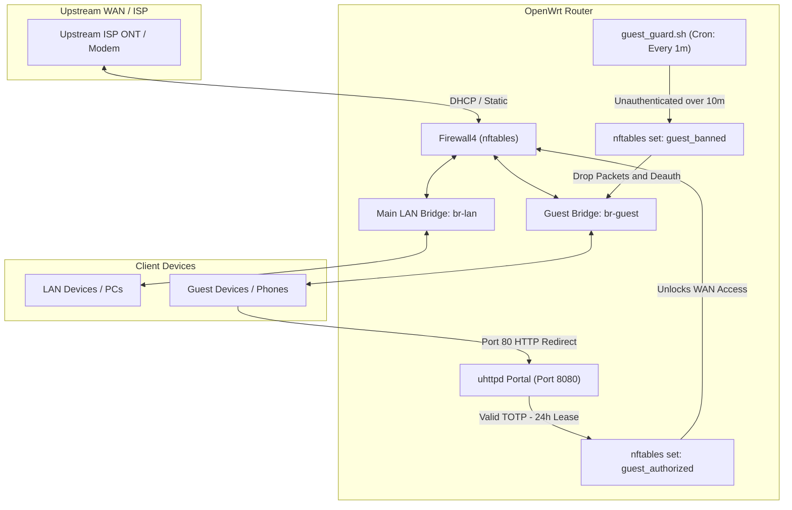

# OpenWrt TOTP Captive Portal & Subnet Isolation Suite

A lightweight, zero-cloud Captive Portal for OpenWrt (Firewall4 / `nftables`). Authenticates guest users via standard **Time-based One-Time Passwords (TOTP)** using Google Authenticator, Proton Authenticator, Aegis, 2FAS, or Bitwarden. 

Features strict private network isolation, dynamic 24-hour leasing, and a 10-minute auto-kick / permanent hardware MAC ban enforcement engine.

---

## Architecture Overview



---

## Key Features

1. **RFC 6238 Standard TOTP Authentication:**
   - Zero external cloud dependencies, radius servers, or databases.
   - Built with native OpenWrt BusyBox shell, OpenSSL, and `uhttpd`.
   - Generates 6-digit codes every 30 seconds with $\pm 1$ step clock skew tolerance.
   - Works completely offline with any standard authenticator app.

2. **Strict Network & Subnet Isolation:**
   - Guests on `br-guest` (`192.168.10.0/24`) cannot communicate with private subnets (`192.168.0.0/16`, `10.0.0.0/8`, `172.16.0.0/12`, Tailscale / CGNAT `100.64.0.0/10`).
   - Router admin services (SSH port 22, LuCI ports 80/443) are completely inaccessible from the guest network.
   - Main LAN maintains unrestricted access to all subnets.

3. **10-Minute Auto-Kick & Permanent MAC Banning:**
   - Background cron guard (`/usr/bin/guest_guard.sh`) tracks connected guest devices.
   - If a client connects to guest Wi-Fi and fails to authenticate within 10 minutes (600 seconds), its MAC address is added to `/etc/guest_permanent_bans.txt`, loaded into nftables `@guest_banned`, and immediately kicked off the Wi-Fi via `hostapd` ubus calls.
   - Permanent bans persist across reboots.

4. **LuCI Web Management:**
   - View banned MACs and unban specific devices (or unban all) directly from LuCI web interface (**System $\rightarrow$ Custom Commands**).

5. **Optimized Wi-Fi Compatibility:**
   - Tuned for modern Wi-Fi 6 (Qualcomm ath11k / ath12k / MediaTek / Realtek).
   - Eliminates DFS radar timeouts and regulatory firmware resets.

---

## Configuration Variables & Defaults

The following default values are used throughout the templates and can be customized to match your network:

| Variable | Description | Default Placeholder |
| :--- | :--- | :--- |
| `GUEST_IF` | Guest network bridge interface | `br-guest` |
| `GUEST_IP` | Guest gateway IP address | `192.168.10.1` |
| `GUEST_NETMASK` | Guest network subnet mask | `255.255.255.0` |
| `GUEST_DHCP_START` | Guest DHCP pool start offset | `100` (`192.168.10.100`) |
| `GUEST_DHCP_LIMIT` | Number of DHCP leases in guest pool | `150` (to `.249`) |
| `GUEST_LEASE_TIME` | Guest DHCP lease duration | `1h` |
| `PORTAL_PORT` | Port for captive portal web server | `8080` |
| `BAN_TIMEOUT` | Unauthenticated timeout before MAC ban | `600` (10 minutes) |
| `GUEST_SSID` | Guest Wi-Fi Network Name | `Guest_WiFi` |

---

## Project Structure

```text
.
├── install.sh                     # Automated deployment script (with configurable header)
├── generate_totp.sh               # 160-bit TOTP secret generator & Base32 printer
├── etc/
│   └── nftables.d/
│       └── 20-guest-portal.nft    # Custom fw4 nftables rules (isolation, redirect, sets)
├── usr/
│   └── bin/
│       ├── guest_guard.sh         # Background 10-minute enforcement guard
│       └── guest_unban.sh         # CLI & LuCI unban management utility
└── www/
    └── guest/
        ├── index.html             # Responsive dark-mode captive portal landing page
        └── cgi-bin/
            ├── splash             # HTTP 302 captive portal splash redirect
            └── auth               # TOTP HMAC-SHA1 verification CGI script
```

---

## Installation Guide

### Method 1: Automated Script

1. Copy the repository files to your OpenWrt router:
   ```sh
   scp -r * root@<ROUTER_LAN_IP>:/tmp/portal/
   ```

2. SSH into your router:
   ```sh
   ssh root@<ROUTER_LAN_IP>
   cd /tmp/portal
   chmod +x install.sh generate_totp.sh usr/bin/*.sh www/guest/cgi-bin/*
   ./install.sh
   ```

3. Note down the **Base32 Secret Key** printed at the conclusion of the script and add it to your authenticator app.

---

### Method 2: Manual Step-by-Step Configuration

#### Step 1: Install OpenSSL Utility
```sh
# On OpenWrt 24+ (apk):
apk update && apk add openssl-util

# On OpenWrt 22.03 / 23.05 (opkg):
opkg update && opkg install openssl-util
```

#### Step 2: Create the Isolated Guest Bridge & Network
```sh
# Create bridge device br-guest
uci set network.br_guest=device
uci set network.br_guest.name='br-guest'
uci set network.br_guest.type='bridge'
uci set network.br_guest.bridge_empty='1'

# Create guest interface
uci set network.guest=interface
uci set network.guest.device='br-guest'
uci set network.guest.proto='static'
uci set network.guest.ipaddr='192.168.10.1'
uci set network.guest.netmask='255.255.255.0'
uci set network.guest.ip6assign='0'
uci commit network

# Setup DHCP server for guest pool (192.168.10.100 - 192.168.10.249)
uci set dhcp.guest=dhcp
uci set dhcp.guest.interface='guest'
uci set dhcp.guest.dhcpv4='server'
uci set dhcp.guest.start='100'
uci set dhcp.guest.limit='150'
uci set dhcp.guest.leasetime='1h'
uci set dhcp.guest.ra='disabled'
uci set dhcp.guest.dhcpv6='disabled'
uci set dhcp.guest.ndp='disabled'
uci commit dhcp
```

#### Step 3: Configure Firewall Zones & Forwarding
```sh
uci add firewall zone
uci set firewall.@zone[-1].name='guest'
uci set firewall.@zone[-1].network='guest'
uci set firewall.@zone[-1].input='DROP'
uci set firewall.@zone[-1].output='ACCEPT'
uci set firewall.@zone[-1].forward='DROP'

uci add firewall forwarding
uci set firewall.@forwarding[-1].src='guest'
uci set firewall.@forwarding[-1].dest='wan'

uci add firewall forwarding
uci set firewall.@forwarding[-1].src='lan'
uci set firewall.@forwarding[-1].dest='guest'

# Allow DHCP requests from guests (UDP 67-68)
uci add firewall rule
uci set firewall.@rule[-1].name='Guest-DHCP'
uci set firewall.@rule[-1].src='guest'
uci set firewall.@rule[-1].proto='udp'
uci set firewall.@rule[-1].dest_port='67-68'
uci set firewall.@rule[-1].target='ACCEPT'

# Allow DNS queries from guests (UDP/TCP 53)
uci add firewall rule
uci set firewall.@rule[-1].name='Guest-DNS'
uci set firewall.@rule[-1].src='guest'
uci set firewall.@rule[-1].proto='tcp udp'
uci set firewall.@rule[-1].dest_port='53'
uci set firewall.@rule[-1].target='ACCEPT'

# Allow Captive Portal Web Server (TCP 8080)
uci add firewall rule
uci set firewall.@rule[-1].name='Guest-Portal-HTTP'
uci set firewall.@rule[-1].src='guest'
uci set firewall.@rule[-1].proto='tcp'
uci set firewall.@rule[-1].dest_port='8080'
uci set firewall.@rule[-1].target='ACCEPT'

uci commit firewall
```

#### Step 4: Deploy Custom nftables Ruleset
Deploy `/etc/nftables.d/20-guest-portal.nft`:

```sh
cat << 'EOF' > /etc/nftables.d/20-guest-portal.nft
set guest_authorized {
	type ipv4_addr
	flags timeout
}

set guest_banned {
	type ether_addr
}

chain guest_input {
	type filter hook input priority filter - 10; policy accept;
	iifname "br-guest" ether saddr @guest_banned drop
	iifname "br-guest" ip daddr { 10.0.0.0/8, 172.16.0.0/12, 192.168.0.0/16 } drop
}

chain guest_prerouting {
	type nat hook prerouting priority dstnat - 10; policy accept;
	iifname "br-guest" ether saddr @guest_banned drop
	iifname "br-guest" ip saddr @guest_authorized accept
	iifname "br-guest" tcp dport 80 redirect to :8080
}

chain guest_forward {
	type filter hook forward priority filter - 10; policy accept;
	iifname "br-guest" ether saddr @guest_banned drop
	iifname "br-guest" meta nfproto ipv6 drop
	iifname "br-guest" ip daddr { 10.0.0.0/8, 100.64.0.0/10, 172.16.0.0/12, 192.168.0.0/16 } drop
	iifname "br-guest" ip saddr @guest_authorized accept
	iifname "br-guest" drop
}
EOF

/etc/init.d/firewall restart
```

#### Step 5: Generate the TOTP Seed Value
Run the generation snippet to create a 160-bit cryptographic seed in `/etc/guest_totp.hex` and print its Base32 secret:

```sh
head -c 20 /dev/urandom | hexdump -v -e '1/1 "%02x"' > /etc/guest_totp.hex
chmod 600 /etc/guest_totp.hex

HEX_KEY=$(cat /etc/guest_totp.hex)
B32_CHARS="ABCDEFGHIJKLMNOPQRSTUVWXYZ234567"
B32_KEY=""

for i in 1 6 11 16 21 26 31 36; do
    CHUNK=$(echo "$HEX_KEY" | cut -c $i-$((i+4)))
    [ ${#CHUNK} -lt 5 ] && break
    VAL=$(( 0x$CHUNK ))
    for shift in 15 10 5 0; do
        IDX=$(( ((VAL >> shift) & 31) + 1 ))
        B32_KEY="${B32_KEY}$(echo "$B32_CHARS" | cut -c $IDX)"
    done
done

echo "=========================================="
echo "Add to Google / Proton Authenticator:"
echo "Secret Key (Base32): $B32_KEY"
echo "Algorithm: SHA1"
echo "Type: Time-based (TOTP, 6 digits, 30s)"
echo "=========================================="
```

#### Step 6: Deploy Captive Portal Web Server & CGI
```sh
mkdir -p /www/guest/cgi-bin

cp www/guest/index.html /www/guest/index.html
cp www/guest/cgi-bin/splash /www/guest/cgi-bin/splash
cp www/guest/cgi-bin/auth /www/guest/cgi-bin/auth

chmod +x /www/guest/cgi-bin/splash /www/guest/cgi-bin/auth

# Bind uhttpd instance to port 8080 on 192.168.10.1
uci set uhttpd.guest=uhttpd
uci set uhttpd.guest.listen_http='192.168.10.1:8080'
uci set uhttpd.guest.home='/www/guest'
uci set uhttpd.guest.cgi_prefix='/cgi-bin'
uci set uhttpd.guest.error_page='/cgi-bin/splash'
uci set uhttpd.guest.no_symlinks='1'
uci commit uhttpd

/etc/init.d/uhttpd restart
```

#### Step 7: Deploy Guard & Unban Management Scripts
```sh
cp usr/bin/guest_guard.sh /usr/bin/guest_guard.sh
cp usr/bin/guest_unban.sh /usr/bin/guest_unban.sh
chmod +x /usr/bin/guest_guard.sh /usr/bin/guest_unban.sh

# Register in cron
mkdir -p /etc/crontabs
touch /etc/crontabs/root
grep -q "guest_guard.sh" /etc/crontabs/root || echo "* * * * * /usr/bin/guest_guard.sh" >> /etc/crontabs/root
/etc/init.d/cron enable
/etc/init.d/cron restart

# Add LuCI custom commands
uci add luci command
uci set luci.@command[-1].name='Unban Guest MAC (enter MAC or "all")'
uci set luci.@command[-1].command='/usr/bin/guest_unban.sh'
uci set luci.@command[-1].param='1'

uci add luci command
uci set luci.@command[-1].name='Show Banned Guest MACs'
uci set luci.@command[-1].command='cat /etc/guest_permanent_bans.txt'
uci commit luci
```

#### Step 8: Configure Wi-Fi SSIDs
In `/etc/config/wireless`, create the guest APs bound to `network 'guest'`:

```uci
config wifi-iface 'wifinet_guest_2g'
    option device 'radio0'
    option mode 'ap'
    option ssid 'Guest_WiFi'
    option encryption 'none'
    option isolate '1'
    option network 'guest'

config wifi-iface 'wifinet_guest_5g'
    option device 'radio1'
    option mode 'ap'
    option ssid 'Guest_WiFi'
    option encryption 'none'
    option isolate '1'
    option network 'guest'
```
Reload Wi-Fi:
```sh
wifi reload
```

---

## Technical Deep-Dive & Real-World Gotchas

### 1. OpenWrt Firewall4 (fw4) Include Scope
- **The Problem:** In OpenWrt fw4, files in `/etc/nftables.d/*.nft` are included **inside** the generated `table inet fw4 { ... }` block.
- **The Pitfall:** Writing `table inet fw4 { ... }` or `add set inet fw4 ...` or `add chain ...` causes compiler syntax errors (`unexpected table`, `unexpected add`). When fw4 fails to compile, it aborts the entire firewall, dropping NAT masquerading and killing WAN connectivity.
- **The Solution:** Rules in `/etc/nftables.d/` must use raw block syntax (`set name { ... }`, `chain name { ... }`) without table definitions or `add` prefixes.

### 2. Nftables Empty Set Matching Gotcha
- **The Problem:** In nftables, relational operators (`!=`) test against *elements within the set*.
- **The Pitfall:** If `@guest_authorized` is empty, the condition `ip saddr != @guest_authorized` evaluates to **FALSE** because there are no elements in the set to compare against. Unauthenticated traffic leaks through to the WAN!
- **The Solution:** Use explicit positive matching followed by a catch-all drop:
  ```nftables
  iifname "br-guest" ip saddr @guest_authorized accept
  iifname "br-guest" drop
  ```

### 3. OpenWrt 24+ dnsmasq `dhcpv4` Server Flag
- **The Problem:** In modern OpenWrt releases, `dnsmasq` defaults `dhcpv4` to `disabled` unless explicitly specified.
- **The Pitfall:** Creating `config dhcp 'guest'` without `option dhcpv4 'server'` causes dnsmasq to ignore the guest pool completely, logging:
  `daemon.warn dnsmasq-dhcp: no address range available for DHCP request via br-guest`
- **The Solution:** Explicitly declare `option dhcpv4 'server'` in `config dhcp 'guest'`.

### 4. Qualcomm ath11k Hardware MAC Mask Enforcement
- **The Problem:** Setting `option macaddr 'random'` on Virtual APs (VAPs) generates arbitrary random MAC addresses.
- **The Pitfall:** Qualcomm ath11k / ath12k Wi-Fi 6 hardware enforces hardware-level BSSID masks. When a random MAC violates the hardware mask, the radio allows 802.11 association, but the hardware RX filter silently drops all incoming broadcast/multicast data frames (including DHCP Discover). Clients become permanently stuck on *"Obtaining IP address..."*.
- **The Solution:** Do not use `option macaddr 'random'`. Let OpenWrt assign canonical sequential MAC addresses that conform to the hardware mask.

### 5. RFC 6238 TOTP Key Length vs Base32 Truncation
- **The Problem:** Standard SHA-1 TOTP uses a **20-byte (160-bit)** secret key.
- **The Pitfall:** Generating a 32-byte (256-bit) secret with `head -c 32 /dev/urandom` produces 64 hex characters. Standard Base32 conversion scripts only read 8 chunks of 5 hex chars (40 hex chars = 20 bytes = 32 Base32 characters). The phone app hashes with only the first 20 bytes, while `openssl HMAC` on the router hashes with all 32 bytes, causing 100% code mismatch!
- **The Solution:** Generate exactly 20 bytes (`head -c 20 /dev/urandom`). 20 bytes maps 1:1 to a 32-character Base32 key with zero truncation and zero padding.

### 6. Non-DFS Wi-Fi Channel Stability
- **The Problem:** Using DFS channels (e.g. Channel 100 or Channel 136) in 80/160 MHz modes triggers 60-second Channel Availability Checks (CAC) and ring-buffer watchdog resets upon client association.
- **The Pitfall:** Clients frequently drop or fail to associate during background radar checks.
- **The Solution:** Fix 5 GHz to **Channel 36** (HE80) and 2.4 GHz to **Channel 6** (HE20) for zero-wait, universal client connection.

---

## LuCI Administration & Management

Navigate to **LuCI $\rightarrow$ System $\rightarrow$ Custom Commands**:

1. **Show Banned Guest MACs:**
   Displays all devices that exceeded the 10-minute unauthenticated window.
2. **Unban Guest MAC:**
   - Enter a specific MAC (e.g. `<TARGET_MAC_ADDRESS>`) to unban a single device.
   - Enter `all` to flush the entire ban list and clear nftables.

---

## Verification & Testing Commands

Verify the active setup from the router terminal:

```sh
# 1. Check active authorized guest IPs and remaining lease times
nft list set inet fw4 guest_authorized

# 2. Check banned hardware MACs
nft list set inet fw4 guest_banned
cat /etc/guest_permanent_bans.txt

# 3. Check active DHCP leases
cat /tmp/dhcp.leases

# 4. Check guest portal web server status
netstat -tuln | grep 8080

# 5. Flush all permanent bans
/usr/bin/guest_unban.sh all
```

---

## License

MIT License. Free to use, modify, and distribute for personal and enterprise OpenWrt deployments.
